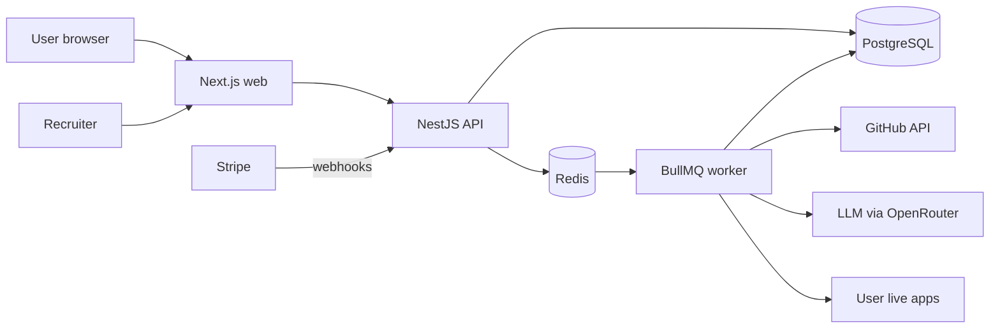
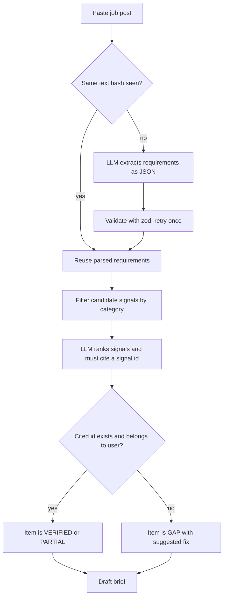
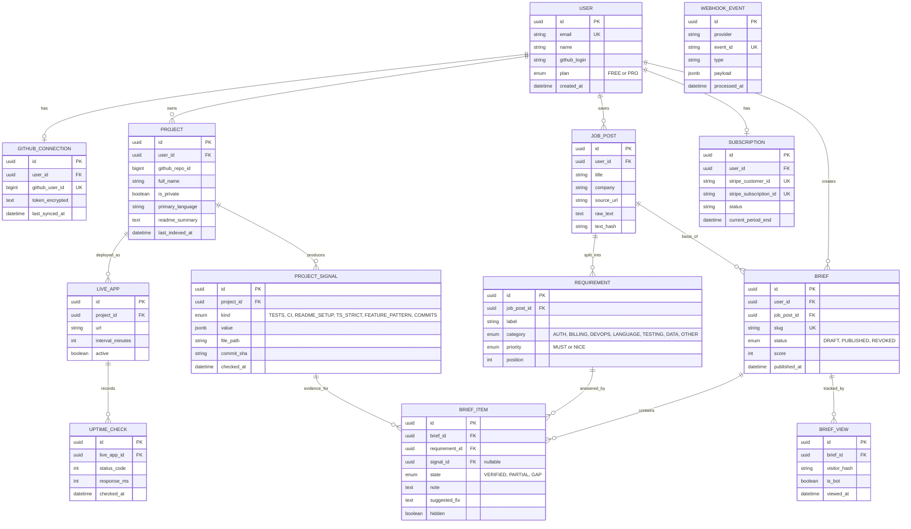

# Shipproof: development plan

A 10-week build plan for a proof-of-work SaaS. Assumes about 15 to 20 focused hours per week. Every week ends with something you can demo and deploy.

## 1. Product one-pager

**Problem.** Junior and freelance developers list skills that reviewers cannot verify, so applications get skipped.

**Solution.** The user connects GitHub, adds live URLs and pastes a job post. Shipproof splits the post into requirements, matches each to checked evidence, and publishes a short brief link to send with the application.

**MVP rules (what makes it a product, not a demo)**

- A brief item is only `VERIFIED` if it cites a stored evidence signal. No signal means `GAP`. The LLM never decides alone.
- Private repo code never appears on a brief. Only check results appear, such as "tests passing".
- Every row is scoped to a user. Free plan: 3 briefs per month.

**Non-goals for v1:** résumé generation, auto-apply, job board scraping, team accounts, mobile app.

## 2. Stack and the reasons

| Layer | Choice | Reason |
| --- | --- | --- |
| Web | Next.js on Vercel | SSR public brief page and Open Graph image |
| API | NestJS | Modules, guards and queues show backend depth |
| DB | PostgreSQL on Supabase, Prisma | Relational data, migrations |
| Queue | Redis with BullMQ | Repo indexing and uptime checks must run outside request time |
| Auth | Supabase Auth, GitHub provider | Fast, and GitHub login is the right fit for the audience |
| LLM | OpenRouter, schema-validated output with zod | Cheap models for parsing, one stronger model for ranking |
| Billing | Stripe Checkout and webhooks | Standard SaaS skill hiring teams ask for |

**Hosting note.** Vercel cannot run BullMQ workers. Host the API and worker on Railway, Fly or Render (one service, two processes). If you want fewer moving parts, replace BullMQ with Vercel Cron plus a jobs table, and write that choice down in an ADR.

## 3. Architecture



**Brief generation pipeline**



## 4. ERD



**Index and constraint notes**

- `PROJECT (user_id, github_repo_id)` unique. `JOB_POST (user_id, text_hash)` unique, which gives you the parse cache.
- `UPTIME_CHECK (live_app_id, checked_at desc)` index. Keep 30 days, then delete in a nightly job.
- `WEBHOOK_EVENT.event_id` unique is your Stripe idempotency guard.
- `BRIEF_ITEM.signal_id` must belong to a project of the same user. Enforce in the service and in a test.

## 5. API surface

| Method and path | Purpose |
| --- | --- |
| `GET /me` | Current user and plan |
| `GET /github/repos` | Repos available to import |
| `POST /projects` | Import selected repos and queue indexing |
| `GET /projects/:id` | Project with signals |
| `POST /projects/:id/live-apps` | Add and validate a live URL |
| `POST /job-posts` | Save a post and queue requirement parsing |
| `POST /briefs` | Generate a draft from a job post |
| `PATCH /briefs/:id/items/:itemId` | Swap project, hide, edit note |
| `POST /briefs/:id/publish` and `/revoke` | Publish or revoke the link |
| `GET /public/briefs/:slug` | Public data, no auth, rate limited |
| `POST /billing/checkout` and `/billing/portal` | Stripe sessions |
| `POST /webhooks/stripe` | Signed, idempotent |

Error format for every endpoint: `{ code, message, details? }`. Decide this in week 1.

## 6. Week-by-week plan

**Week 1: Foundation**

- pnpm monorepo: `apps/web`, `apps/api`, `packages/db` (Prisma), `packages/shared` (zod schemas).
- Prisma schema from the ERD, first migration, seed script.
- GitHub Actions: lint, typecheck, test. Deploy empty web and API.
- Deploy the landing page at the web root.
- *Done when:* CI is green and both deployed URLs respond.

**Week 2: Auth and GitHub connect**

- Login with GitHub through Supabase Auth. NestJS guard that validates the session and loads the user.
- Store the GitHub token encrypted (AES-GCM, key from env).
- Global rule: every query takes `userId`. Write one test that proves user A cannot read user B's project.
- *Done when:* you can log in and see your own repo list.

**Week 3: Repo import and indexing**

- BullMQ queue and worker process. Octokit with conditional requests (ETag) and rate-limit handling.
- Indexer writes signals: tests present, CI workflow and last runs, README setup section, TypeScript strict flag, commit counts and authorship.
- Retry with backoff. Job status endpoint.
- *Done when:* importing a repo produces signals visible in a project page.

**Week 4: Live app checks**

- Add a URL, then a repeatable job checks it on an interval. Save status, latency and security headers.
- Block SSRF: resolve DNS, reject private and loopback IPs, limit redirects, set a timeout.
- Uptime summary: percent over 7 days.
- *Done when:* a deployed app shows a 7-day uptime figure and a blocked internal URL returns a clear error.

**Week 5: Job post parsing**

- `POST /job-posts` with raw text, then LLM returns requirements as JSON. Validate with zod, retry once, store `text_hash` cache.
- Build an evaluation set: 15 real job posts with the requirements you expect. Script prints how many were extracted correctly.
- *Done when:* the eval script runs in CI and you know your accuracy number.

**Week 6: Matching engine (the core of the product)**

- Step 1: map requirement category to candidate signal kinds.
- Step 2: LLM ranks candidates and must return a signal id. Reject any id that is not in the candidate list.
- Step 3: derive `VERIFIED`, `PARTIAL` or `GAP`. Generate a suggested fix for gaps.
- Compute brief score as verified must-have items over total must-have items.
- *Done when:* the eval set produces briefs and no item is ever verified without a real signal.

**Week 7: Brief editor and public page**

- Editor: swap project, hide item, edit note, publish and revoke.
- Public SSR page at `/b/:slug` with Open Graph image. Revoked links return 410.
- View tracking: hashed IP plus date, bot user-agent filter, rate limit.
- *Done when:* you send a link to a friend and see the view count rise once, not on refresh spam.

**Week 8: Billing and plan limits**

- Stripe Checkout and customer portal. Webhook: verify signature, insert `WEBHOOK_EVENT`, skip if the event id exists.
- A plan guard enforces 3 briefs per month on Free.
- Use test mode only until week 10.
- *Done when:* upgrading in test mode unlocks unlimited briefs, and replaying the same webhook changes nothing.

**Week 9: Hardening**

- Tests: unit tests for the matching rules, e2e for import to publish, one Playwright run.
- Rate limits, structured logs, Sentry, health endpoint.
- Security pass: token encryption, SSRF test, private data never in the public payload (write a test that fails if it is).
- *Done when:* a fresh clone runs `pnpm test` and passes.

**Week 10: Launch and job-search packaging**

- Replace the waitlist form with real signup.
- README: problem, architecture diagram, ERD, setup in 5 commands, known limits.
- 3-minute demo video and a one-page case study.
- Generate a real Shipproof brief for a job you are applying to and send it.
- *Done when:* you can send one link to an employer that shows the product and the code.

**If you fall behind:** protect weeks 1 to 7. Billing (week 8) can be reduced to a test-mode Stripe Checkout with a webhook, which still demonstrates the skill.

## 7. Decisions to write as short ADRs (one paragraph each)

1. Evidence-first matching: why the LLM cannot verify on its own.
2. BullMQ worker versus cron and a jobs table.
3. Supabase Auth versus rolling your own GitHub OAuth.
4. Storing check results, not code, for private repos.
5. Idempotent webhooks through a unique event id.

Interviewers ask "why did you choose X". These five answers are your interview material.

## 8. Risks

| Risk | Mitigation |
| --- | --- |
| GitHub API rate limits | ETag caching, index on import and on push only |
| LLM output is inconsistent | Schema validation, eval set, fixed prompts in version control |
| Users fear exposing private code | Show only check results, and let users preview the public payload |
| Scope creep | Anything not in sections 1 to 6 goes into a "later" list |

## 9. Repo layout

```
shipproof/
  apps/web        Next.js (landing, dashboard, /b/:slug)
  apps/api        NestJS (modules: auth, github, projects, jobs, briefs, billing)
  packages/db     Prisma schema and migrations
  packages/shared zod schemas and types
  docs/           adr/, erd.md, api.md, runbook.md
  evals/          job posts and expected requirements
```